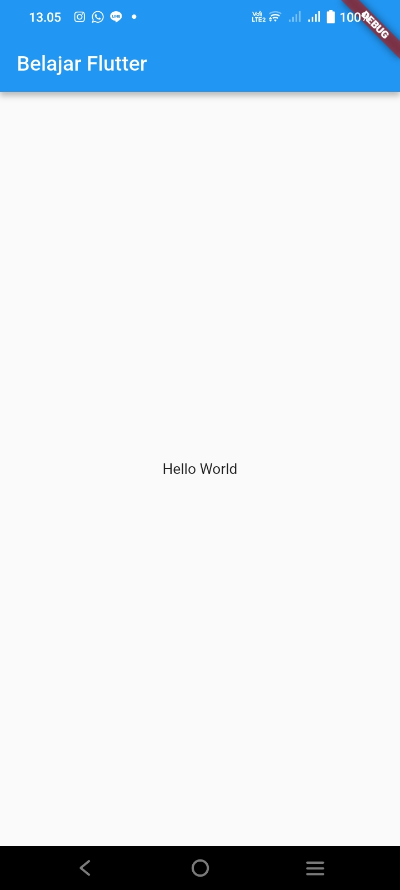
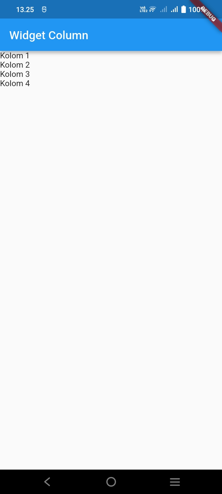
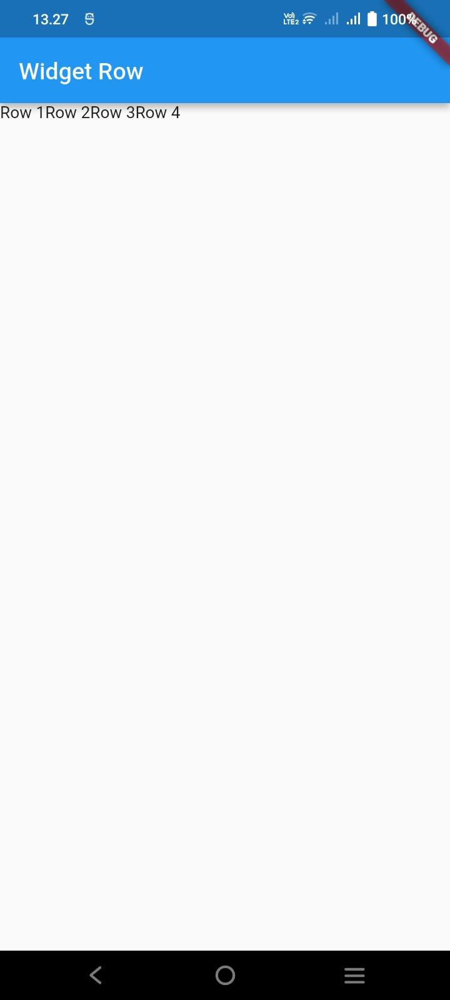
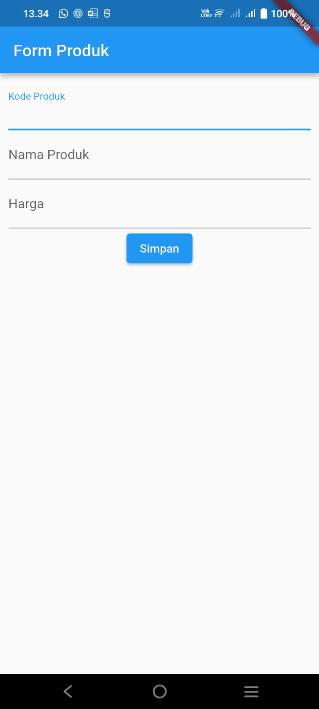
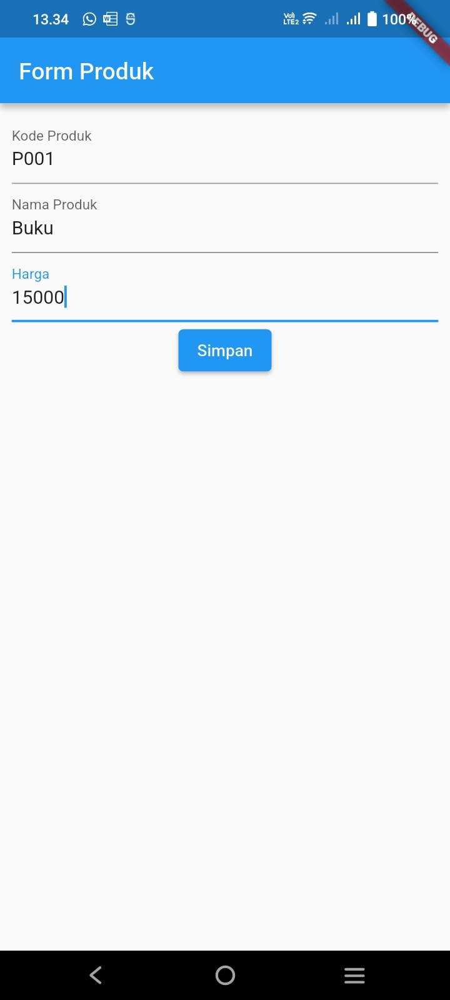
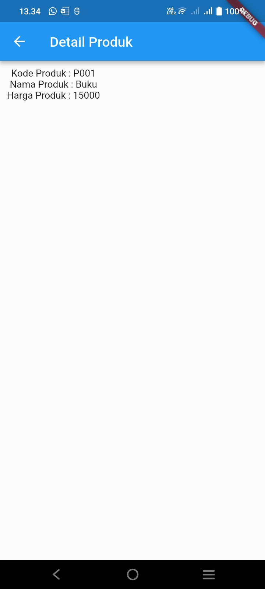
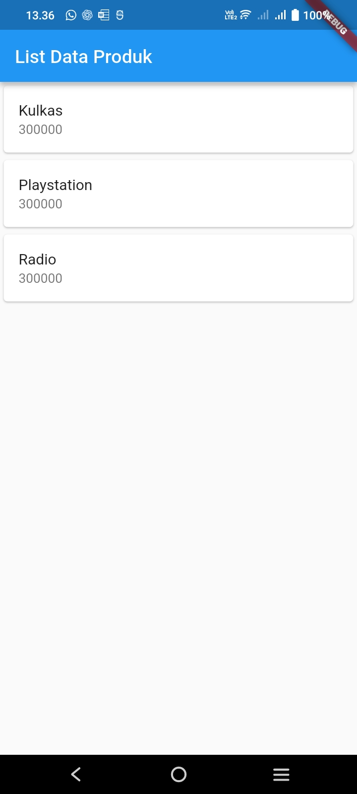

# PrakPemrogramanMobile-H1D024109-Dart

**Nama**        : Atika Cinta Khaerunnisa  
**NIM**         : H1D024109  
**Shift Awal**  : G  
**Shift Akhir** : B  
**Praktikum**   : Pemrograman Mobile  

---

## Modul 1 — Pengenalan Bahasa Dart

- **File**: `main.dart`
- Implementasi Struktur Data Queue (Antrian) menggunakan bahasa pemrograman Dart (metode `enqueue`, `pop`, dan `tampilkanAntrian`).

---

## Modul 2 — Pengenalan dan Desain Framework Flutter

**Tanggal**: Rabu, 21 Oktober 2026  
**Direktori Proyek**: `belajarflutter/`

### 1. Hello World pada Flutter

Pada bagian ini, aplikasi sederhana dibuat menggunakan framework Flutter dengan bahasa pemrograman Dart. Implementasi menggunakan `StatelessWidget` sebagai widget induk, `MaterialApp` sebagai pembungkus aplikasi, `Scaffold` sebagai struktur dasar halaman, `AppBar` untuk menampilkan judul halaman, serta `Center` dan `Text` untuk menampilkan tulisan Hello World.

Implementasi awal dibuat pada file `belajarflutter/lib/main.dart`.

### 2. Bekerja dengan Beberapa File Dart

Untuk mempermudah pembacaan dan pemeliharaan kode, implementasi halaman dipisahkan menjadi beberapa file Dart:

- `belajarflutter/lib/main.dart`: berisi fungsi `main()` dan kelas `MyApp` yang menjalankan aplikasi melalui `MaterialApp` (dilengkapi `MenuPage` untuk mengakses semua halaman latihan).
- `belajarflutter/lib/hello_world.dart`: berisi kelas `HelloWorld` yang menampilkan halaman menggunakan `Scaffold`, `AppBar`, `Center`, dan `Text`.

### 3. Kolom pada Flutter

Widget `Column` digunakan untuk menyusun beberapa widget secara vertikal. Implementasi dibuat pada file `belajarflutter/lib/column_widget.dart` menggunakan kelas `ColumnWidget` dengan empat widget `Text`, yaitu Kolom 1, Kolom 2, Kolom 3, dan Kolom 4.

### 4. Membuat Row pada Flutter

Widget `Row` digunakan untuk menampilkan beberapa widget secara horizontal. Implementasi dibuat pada file `belajarflutter/lib/row_widget.dart` menggunakan kelas `RowWidget` yang menampilkan Row 1, Row 2, Row 3, dan Row 4.

### 5. Membuat Form Produk

Form Produk dibuat di dalam folder `belajarflutter/lib/ui` menggunakan `StatefulWidget`, `TextEditingController`, `TextField`, dan `ElevatedButton`.

Form terdiri atas tiga masukan, yaitu kode produk, nama produk, dan harga. Ketika tombol **Simpan** ditekan, data yang dimasukkan diteruskan ke halaman detail menggunakan `Navigator` dan `MaterialPageRoute`.

File implementasi yang digunakan:
- `belajarflutter/lib/ui/produk_form.dart`: menampilkan form input produk.
- `belajarflutter/lib/ui/produk_detail.dart`: menampilkan detail produk berdasarkan data yang dimasukkan.

**Tampilan Form Produk**

**Tampilan Form Produk Input**

**Hasil Detail Produk**

### 6. Membuat ListView pada Flutter

Widget `ListView` digunakan untuk menampilkan daftar produk secara vertikal. Implementasi dibuat pada file `belajarflutter/lib/ui/produk_page.dart` menggunakan `StatefulWidget`, `ListView`, `Card`, dan `ListTile`.

| Nama Produk | Harga |
|---|---:|
| Kulkas | 30000 |
| Playstation | 30000 |
| Radio | 30000 |

### 7. Hasil Running pada Emulator Android

Berikut hasil menjalankan setiap halaman Modul 2 pada emulator Android melalui menu navigasi di `main.dart`.

| Hello World | Widget Column | Widget Row |
|:---:|:---:|:---:|
|  |  |  |

| Form Produk | List Data Produk |
|:---:|:---:|
|  |  |

---

## Modul 3 — Routes, Side Menu, Login dan Local Storage

**Tanggal**: Minggu, 8 November 2026  
**Direktori Proyek**: `router_flutter/`

### 1. Menambahkan Dependencies (`shared_preferences`)

Package `shared_preferences` ditambahkan pada `router_flutter/pubspec.yaml` untuk menyimpan data sederhana (seperti username pengguna yang login) ke dalam local storage perangkat.

### 2. Halaman Login (`router_flutter/lib/login_page.dart`)

Halaman login dibangun menggunakan `StatefulWidget` (`LoginPage`) dengan fitur:
- Input username dan password menggunakan `TextField` melalui method `_showInput()`.
- Penyimpanan username ke local storage menggunakan `SharedPreferences` melalui method `_saveUsername()`.
- Simulasi autentikasi menggunakan kredensial `admin` / `admin`.
- Menampilkan pesan konfirmasi menggunakan `AlertDialog` melalui method `_showDialog()`:
  - Jika berhasil, diarahkan ke `HomePage`.
  - Jika gagal, diarahkan kembali ke `LoginPage`.

### 3. Halaman Utama (`router_flutter/lib/home_page.dart`)

Halaman utama (`HomePage`) mengambil kembali username yang tersimpan di local storage melalui fungsi `_loadUsername()` lalu menampilkannya pada layar (`Ini adalah halaman User <namauser>`), serta menyertakan komponen `Drawer` (`Sidemenu`).

### 4. Side Menu (`router_flutter/lib/sidemenu.dart`) dan Halaman About (`router_flutter/lib/about_page.dart`)

- `router_flutter/lib/sidemenu.dart`: Widget `Drawer` berisi `DrawerHeader` dan dua `ListTile` (`Home` dan `About`) untuk berpindah antar halaman menggunakan `Navigator.push` dan `MaterialPageRoute`.
- `router_flutter/lib/about_page.dart`: Halaman informasi sederhana yang menampilkan teks `"Ini adalah halaman About"` dan juga dilengkapi `Sidemenu`.

### 5. Titik Masuk Aplikasi (`router_flutter/lib/main.dart`)

`main.dart` menjalankan `MyApp` dengan tema biru Material dan mengarahkan halaman awal (`home`) ke `LoginPage()`.

### 6. Hasil Running pada Emulator Android

Berikut demo hasil menjalankan aplikasi Modul 3 (login `admin`/`admin`, penyimpanan username dengan `SharedPreferences`, serta navigasi Side Menu antara halaman Home dan About):

---

## Modul 4 — Operasi CRUD dengan API CodeIgniter 4 (Bagian 1)

**Tanggal**: Minggu, 15 November 2026  
**Direktori Proyek**: `tokokita/` (Flutter) & `toko-api/` (RESTful API CodeIgniter 4)

### 1. Backend RESTful API (`toko-api/`)

- **Database (`toko-api/toko_api.sql`)**: Skema database `toko_api` dengan tabel `member`, `member_token`, dan `produk`.
- **Models (`toko-api/app/Models/`)**: `MRegistrasi.php`, `MMember.php`, `MLogin.php`, `MProduk.php`.
- **Controllers (`toko-api/app/Controllers/`)**:
  - `RestfulController.php`: Format response JSON standar (`code`, `status`, `data`).
  - `RegistrasiController.php`: Endpoint `POST /registrasi`.
  - `LoginController.php`: Endpoint `POST /login` dengan verifikasi password dan pembuatan `auth_key` token.
  - `ProdukController.php`: Endpoint CRUD produk (`create`, `list`, `detail`, `ubah`, `hapus`).
- **Routes (`toko-api/app/Config/Routes.php`)**: Definisi route `/registrasi`, `/login`, dan group `/produk`.

### 2. Proyek Flutter Toko Kita — Model & UI (`tokokita/`)

- **Models (`tokokita/lib/model/`)**:
  - `login.dart`: Model response login (`code`, `status`, `token`, `userID`, `userEmail`).
  - `registrasi.dart`: Model response registrasi (`code`, `status`, `data`).
  - `produk.dart`: Model data produk (`id`, `kodeProduk`, `namaProduk`, `hargaProduk`).
- **Halaman UI (`tokokita/lib/ui/`)**:
  - `registrasi_page.dart`: Form registrasi (Nama, Email, Password, Konfirmasi Password) dengan validasi `FormState`.
  - `login_page.dart`: Form login (Email, Password) beserta tautan navigasi ke halaman Registrasi.
  - `produk_form.dart`: Form tambah dan ubah produk (`TAMBAH PRODUK` / `UBAH PRODUK`).
  - `produk_detail.dart`: Halaman detail produk dengan tombol `EDIT` (ke `ProdukForm`) dan `DELETE` (konfirmasi `AlertDialog`).
  - `produk_page.dart`: Halaman `List Produk` dengan tombol tambah (`+`), `Drawer` Logout, dan daftar `ItemProduk`.
- **Titik Masuk (`tokokita/lib/main.dart`)**: Menjalankan aplikasi `Toko Kita` dan menampilkan `ProdukPage`.
