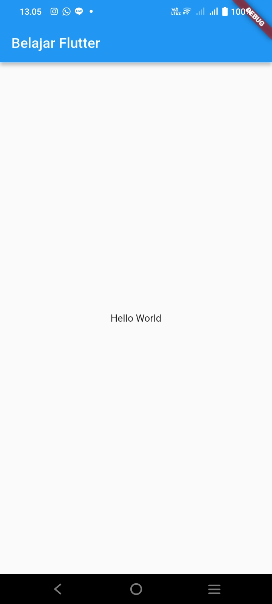
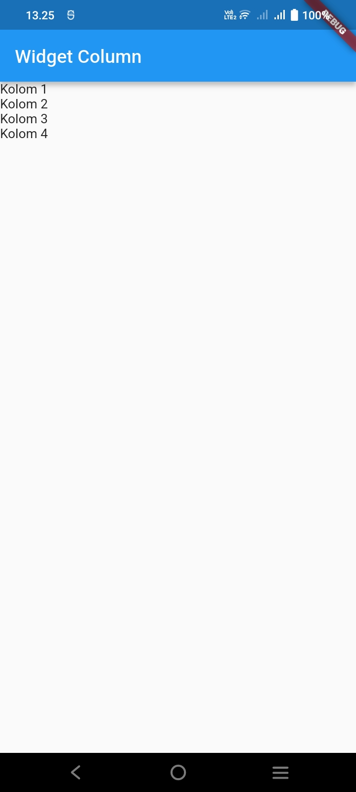
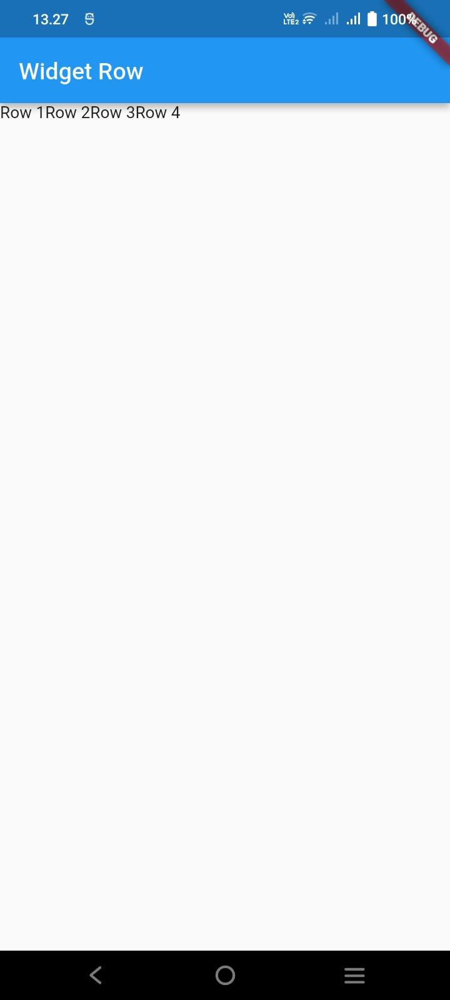
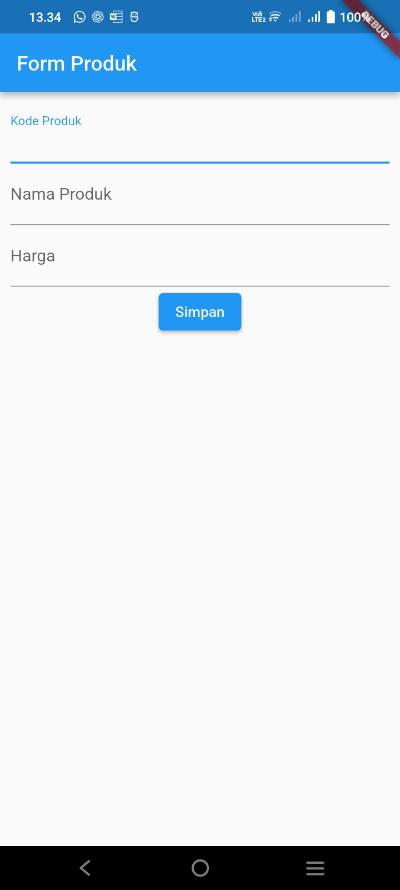
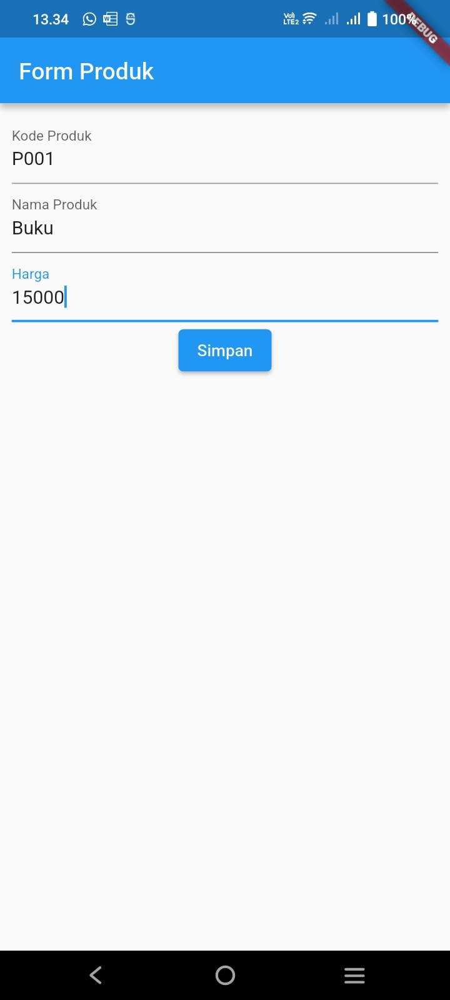
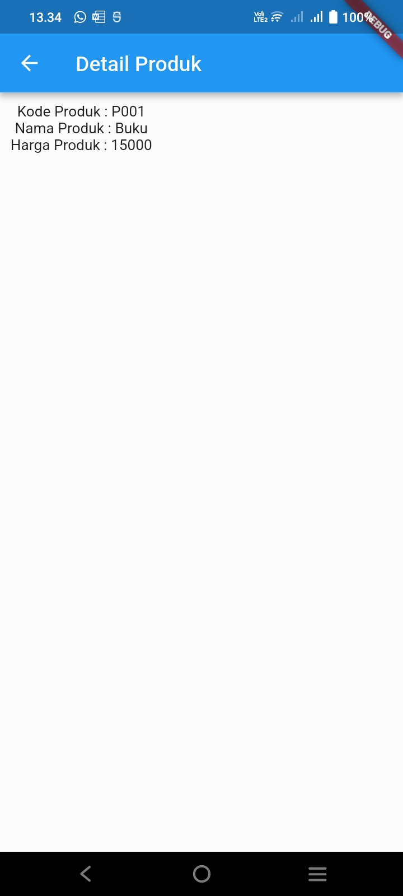
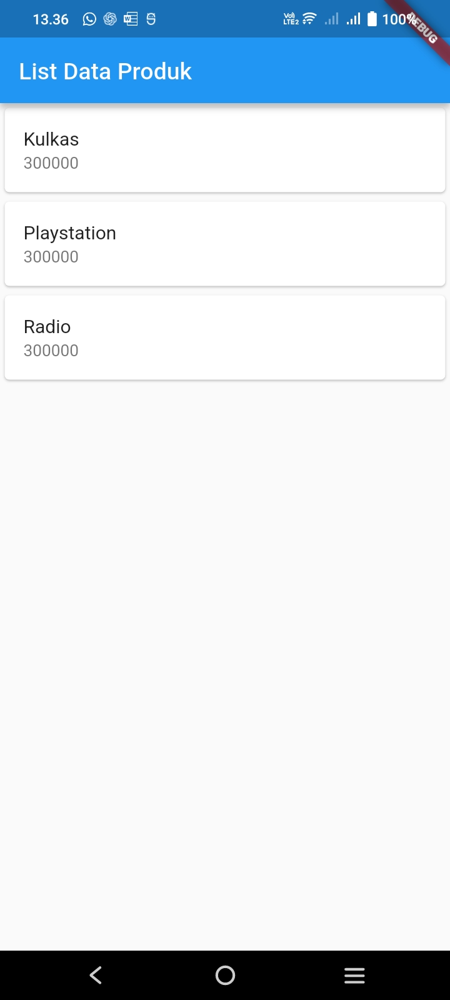

# Laporan Praktikum Pemrograman Mobile

**Nama**        : Atika Cinta Khaerunnisa  
**NIM**         : H1D024109  
**Shift**       : Awal G / Akhir B  
**Praktikum**   : Pemrograman Mobile

---

## 📝 Modul 2 — Pengenalan dan Desain Framework Flutter

**Tanggal**: Rabu, 21 Oktober 2026

### 1. Hello World pada Flutter

Pada bagian ini, aplikasi sederhana dibuat menggunakan framework Flutter dengan bahasa pemrograman Dart. Implementasi menggunakan `StatelessWidget` sebagai widget induk, `MaterialApp` sebagai pembungkus aplikasi, `Scaffold` sebagai struktur dasar halaman, `AppBar` untuk menampilkan judul halaman, serta `Center` dan `Text` untuk menampilkan tulisan Hello World.

Implementasi awal dibuat pada file `lib/main.dart`.

### 2. Bekerja dengan Beberapa File Dart

Untuk mempermudah pembacaan dan pemeliharaan kode, implementasi halaman dipisahkan menjadi beberapa file Dart.

Pembagian file yang digunakan adalah:

- `lib/main.dart`: berisi fungsi `main()` dan kelas `MyApp` yang menjalankan aplikasi melalui `MaterialApp`.
- `lib/hello_world.dart`: berisi kelas `HelloWorld` yang menampilkan halaman menggunakan `Scaffold`, `AppBar`, `Center`, dan `Text`.

Kelas `HelloWorld` dipanggil melalui properti `home` pada `MaterialApp`. Pemisahan ini tidak mengubah tampilan aplikasi, tetapi membuat kode lebih terstruktur.

### 3. Kolom pada Flutter

Widget `Column` digunakan untuk menyusun beberapa widget secara vertikal. Implementasi dibuat pada file `lib/column_widget.dart` menggunakan kelas `ColumnWidget` dengan empat widget `Text`, yaitu Kolom 1, Kolom 2, Kolom 3, dan Kolom 4.

Halaman menggunakan `Scaffold` dan `AppBar` dengan judul **Widget Column**.

### 4. Membuat Row pada Flutter

Widget `Row` digunakan untuk menampilkan beberapa widget secara horizontal. Implementasi dibuat pada file `lib/row_widget.dart` menggunakan kelas `RowWidget` yang menampilkan Row 1, Row 2, Row 3, dan Row 4.

Halaman menggunakan `Scaffold` dan `AppBar` dengan judul **Widget Row**.

### 5. Membuat Form Produk

Form Produk dibuat di dalam folder `lib/ui` menggunakan `StatefulWidget`, `TextEditingController`, `TextField`, dan `ElevatedButton`.

Form terdiri atas tiga masukan, yaitu kode produk, nama produk, dan harga. Ketika tombol **Simpan** ditekan, data yang dimasukkan diteruskan ke halaman detail menggunakan `Navigator` dan `MaterialPageRoute`.

File implementasi yang digunakan:

- `lib/ui/produk_form.dart`: menampilkan form input produk.
- `lib/ui/produk_detail.dart`: menampilkan detail produk berdasarkan data yang dimasukkan.

**Tampilan Form Produk**

**Tampilan Form Produk Input**

**Hasil Detail Produk**

### 6. Membuat ListView pada Flutter

Widget `ListView` digunakan untuk menampilkan daftar produk secara vertikal. Implementasi dibuat pada file `lib/ui/produk_page.dart` menggunakan `StatefulWidget`, `ListView`, `Card`, dan `ListTile`.

Daftar produk yang ditampilkan terdiri atas tiga data berikut:

| Nama Produk | Harga |
|---|---:|
| Kulkas | 30000 |
| Playstation | 30000 |
| Radio | 30000 |

Halaman menggunakan judul **List Data Produk**. Setiap data produk ditampilkan dalam kartu yang berisi nama produk dan harga sebagai subtitle.

### 7. Hasil Running pada Emulator Android

Berikut hasil menjalankan setiap halaman Modul 2 pada emulator Android melalui menu navigasi di `main.dart`.

| Hello World | Widget Column | Widget Row |
|:---:|:---:|:---:|
|  |  |  |

| Form Produk | List Data Produk |
|:---:|:---:|
|  |  |

### Kesimpulan Praktikum

Praktikum Modul 2 memberikan pemahaman mengenai penggunaan framework Flutter untuk membangun antarmuka aplikasi mobile multiplatform. Materi yang dipraktikkan meliputi pembuatan aplikasi Hello World, pemisahan kode menjadi beberapa file Dart, penyusunan widget secara vertikal dan horizontal menggunakan `Column` dan `Row`, pembuatan form produk beserta navigasi ke halaman detail menggunakan `Navigator`, serta penyajian daftar produk menggunakan `ListView`, `Card`, dan `ListTile`.

Implementasi dikerjakan dengan bahasa pemrograman Dart dan diuji pada perangkat/emulator Android. Praktikum ini membantu memahami struktur dasar proyek Flutter, penggunaan widget, serta pengolahan input dan penampilan data.
